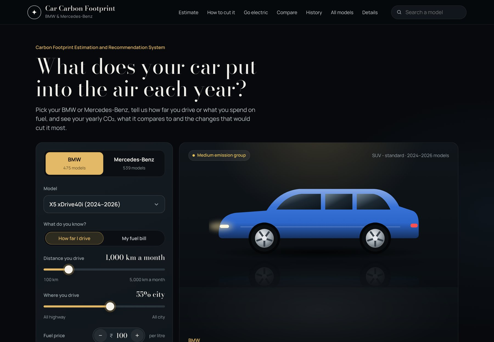
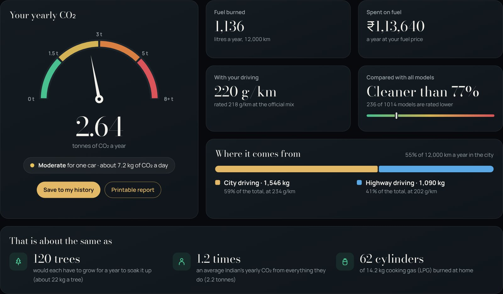
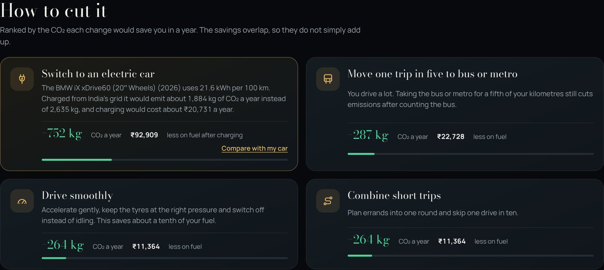
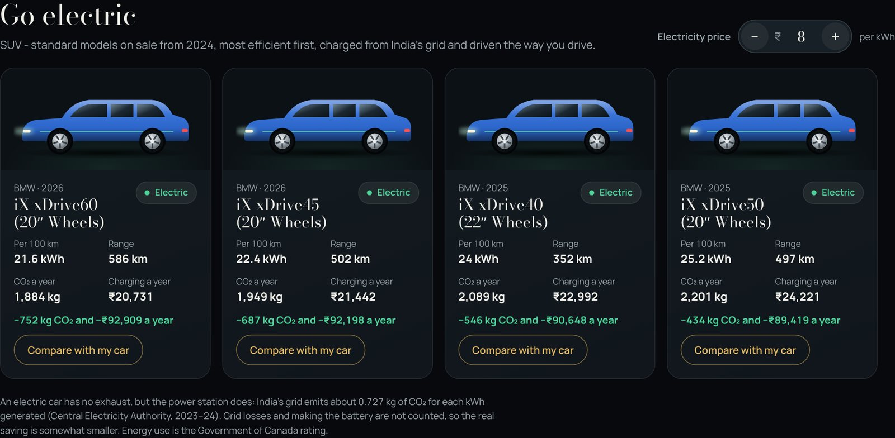
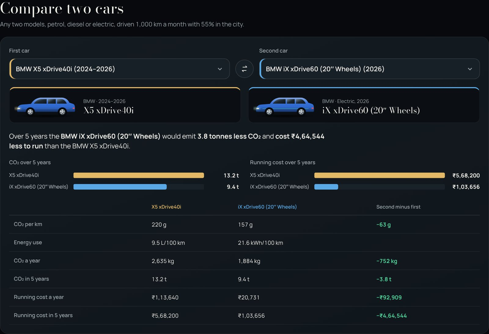
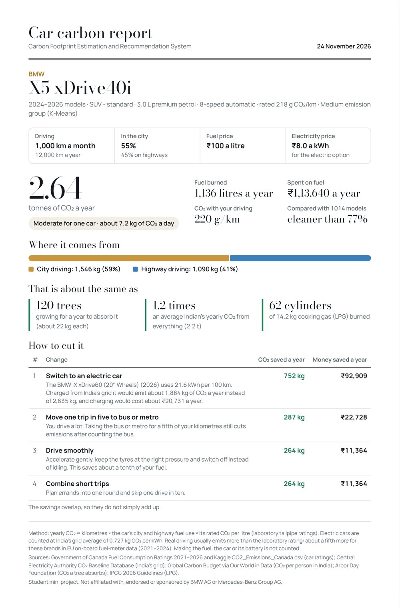
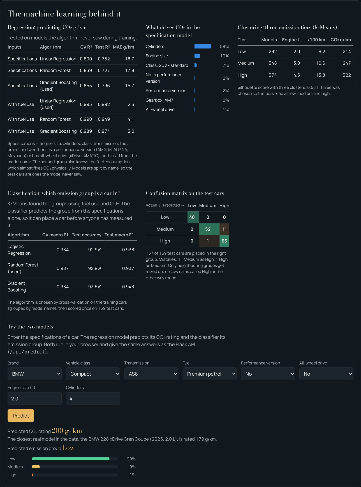
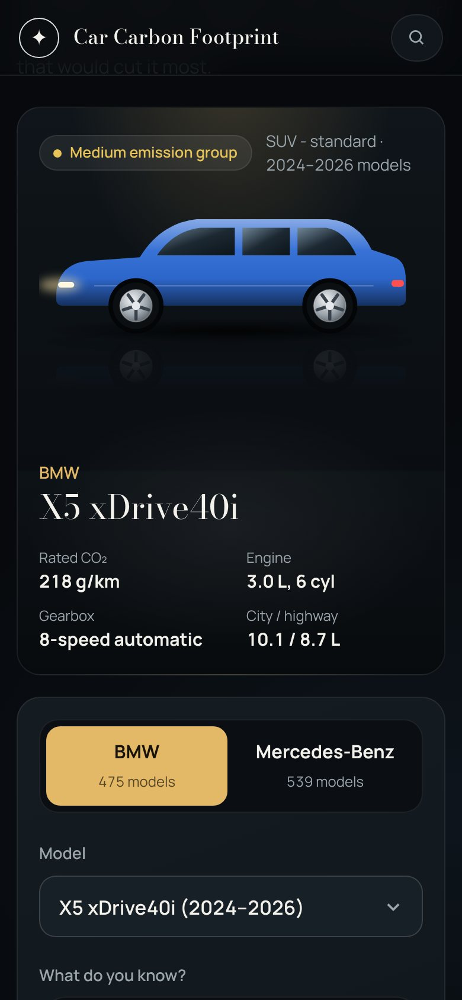

# Carbon Footprint Estimation and Recommendation System

Estimates the yearly carbon footprint of a **BMW or Mercedes-Benz** car from the model and how
it is driven, compares it with electric models, and recommends personalised ways to reduce it.


**Live website:** https://manvith-546.github.io/carbon-footprint-system/  
**Code:** https://github.com/manvith-546/carbon-footprint-system



## What it does

- **Estimate:** pick one of 1,014 BMW and Mercedes-Benz petrol and diesel variants from model
  years 2014 to 2026. Enter either the distance you drive **or your monthly fuel bill**, how much
  of it is in the city and the fuel price. You get the yearly CO₂, litres and fuel cost, split
  into city and highway driving.
- **Put it in everyday terms:** the trees needed to absorb it, how it compares with an average
  Indian's total yearly CO₂, and the same CO₂ in LPG cooking-gas cylinders.
- **Recommend:** ranked suggestions with the kg of CO₂ and rupees each one saves: switching to
  an electric BMW or Mercedes-Benz (charged from India's grid), a cleaner car in the same class,
  and driving habits.
- **Go electric:** the most efficient electric models of your car's class, with their yearly CO₂
  on India's grid and charging cost at your electricity price.
- **Compare two cars:** any two models, petrol, diesel or electric, with the CO₂ and running
  cost over five years.
- **My history:** save estimates and watch the trend. With the Flask server the history is kept
  in a SQLite database; on the static website it is kept in the browser.
- **Printable report:** a one-page A4 car carbon report to print or save as PDF.
- **Machine learning:** regression predicts a car's CO₂ rating from its specifications, K-Means
  groups the cars into low, medium and high emission groups, and a classifier predicts the group
  from the specifications alone.
- **Same answers everywhere:** the Python, Java and JavaScript versions use the same formulas,
  and the tests prove they agree.

| Result | Recommendations |
|---|---|
|  |  |

| Go electric | Compare two cars |
|---|---|
|  |  |

| Printable report | Project details page | On a phone |
|---|---|---|
|  |  |  |

## Run it

You need [Python 3.10 or newer](https://www.python.org/downloads/) (on Windows, tick
**Add python.exe to PATH** when installing). Java and Node.js are optional. Any ordinary laptop
is enough: rebuilding all the data and models takes about 15 seconds.

### Easiest: one file

- **Windows:** double-click `run_website.bat`
- **macOS / Linux:** run `./run_website.sh` in a terminal

The first run creates a virtual environment, installs the packages and trains the models.
Then the website opens at **http://127.0.0.1:8000**. Close the window or press `Ctrl+C` to stop it.

### In VS Code

1. **File > Open Folder** and choose this project folder.
2. Install the recommended extensions when VS Code asks (Python, Java, Live Server).
3. Open a terminal with **Terminal > New Terminal** and run:

   ```
   python -m venv .venv
   .venv\Scripts\python -m pip install -r requirements.txt      (Windows)
   .venv/bin/python -m pip install -r requirements.txt          (macOS / Linux)
   ```

   When VS Code asks, select the `.venv` interpreter (or press `Ctrl+Shift+P` >
   **Python: Select Interpreter** > `.venv`).
4. Start the website with **Terminal > Run Task > 2. Start the website**, or with
   **Run and Debug** (`Ctrl+Shift+D`) > **1. Website (Flask, opens the browser)** > ▶.

Every part of the project is a ready-made task (**Terminal > Run Task**) or a
**Run and Debug** entry:

| What | Task | Command |
|---|---|---|
| Website with the Python backend | 2. Start the website | `python python/app.py` |
| Train the models and rebuild the data | 3. Train models and build the data | `python run_all.py` |
| Terminal estimator (Python) | 4. Terminal estimator | `python python/3_estimate_cli.py` (add `--demo`) |
| Console app (Java) | 5. Console app (Java) | `javac -d java/out java/CarbonFootprintApp.java` then `java -cp java/out CarbonFootprintApp` |
| SQL database and queries | 6. Build the SQL database | `python sql/build_database.py` |
| All tests | 7. Run all tests | `python tests/test_api.py` |

### Without Python

The website is plain HTML, CSS and JavaScript, so it also works without any server: open
`web/index.html` in a browser, or right-click it in VS Code > **Open with Live Server**.
Everything works, including both machine-learning models, because they are exported to
`web/model.js`. Only the history is then kept in the browser instead of the database.

## The live website (GitHub Pages)

The website is published from this repository at
**https://manvith-546.github.io/carbon-footprint-system/**.

Every push to `main` updates it: the **Publish website to GitHub Pages** workflow copies the
`web/` folder to the `gh-pages` branch, and GitHub Pages serves that branch. The **Tests**
workflow also runs on every push and shows a green tick when the Python, JavaScript and Java
results all agree.

If the site ever stops appearing, open the repository on github.com > **Settings** > **Pages** >
**Build and deployment** > **Source: Deploy from a branch** > **Branch: gh-pages**, **/ (root)** > **Save**.

<details>
<summary>Publishing your own copy</summary>

Create an empty public repository on github.com (no README), then in the project folder:

```
git init
git add .
git commit -m "Carbon Footprint Estimation and Recommendation System"
git branch -M main
git remote add origin https://github.com/YOUR-USERNAME/YOUR-REPOSITORY.git
git push -u origin main
```

The workflow then creates the `gh-pages` branch. Turn on Pages as described above, and the
site appears at `https://YOUR-USERNAME.github.io/YOUR-REPOSITORY/`.
</details>

## Project structure

```
├── run_website.bat / run_website.sh   one-click start (Windows / macOS, Linux)
├── run_all.py                  runs the whole pipeline: data -> models -> website data -> database
├── requirements.txt            Python packages
├── data/
│   ├── CO2_Emissions_Canada.csv               main dataset (Kaggle, 2014-2020)
│   ├── canada_2021_2026_bmw_mercedes.csv      newer cars, Government of Canada
│   ├── canada_ev_2012_2026_bmw_mercedes.csv   electric cars, Government of Canada
│   ├── eu_obfcm_bmw_mercedes_2021_2024.csv    EU real-world fleet data
│   ├── emission_factors.csv                   factors, each with its source
│   ├── README.md                              where every file comes from
│   └── processed/                             cleaned data (generated)
├── python/
│   ├── 1_prepare_data.py       merge, clean, check and label the data
│   ├── 2_train_models.py       regression, K-Means, classifier; charts in reports/
│   ├── 3_estimate_cli.py       footprint estimator in the terminal
│   ├── 4_export_web_data.py    exports the data and both models for the website
│   ├── footprint.py            estimation and recommendation logic
│   └── app.py                  Flask server: website + API + saved history
├── java/CarbonFootprintApp.java  console version with its own linear regression
├── web/                        the website (published to GitHub Pages)
│   ├── index.html, app.css, app.js            the estimator
│   ├── report.html, report.css, report.js     printable one-page report
│   ├── details.html, details.css, details.js  data, models and method
│   ├── footprint.js            estimation logic (same formulas as Python and Java)
│   ├── predictor.js            runs the trained models in the browser
│   ├── data.js, model.js       generated by python/4_export_web_data.py
│   ├── fonts/                  self-hosted fonts (SIL Open Font License)
│   └── images/                 optional car photos (see images/README.txt)
├── sql/                        SQLite schema, queries, history table and builder
├── reports/                    charts and metrics.json (generated)
├── tests/                      test_api.py, check_consistency.js, fixtures/
├── docs/screenshots/           pictures used in this README
├── .vscode/                    tasks, run configurations, recommended extensions
└── .github/workflows/          GitHub Pages deployment and tests
```

## How it works

### 1. Data

The Kaggle file covers model years 2014 to 2020. Newer cars, 2021 to 2026, come from the
Government of Canada's own rating files (the same source the Kaggle file was built from), and
electric cars from its battery-electric file. `python/1_prepare_data.py`:

- keeps only BMW and Mercedes-Benz, merges the sources and removes duplicate rows
  (1,341 rows: 852 from Kaggle, 489 newer);
- **checks the data**: CO₂ per litre of fuel is a physical constant for each fuel, so any row
  more than 8% away from its fuel's typical value is dropped as an error (5 rows);
- reads two features from the model name: **performance version** (AMG, M, ALPINA, Maybach,
  Competition) and **all-wheel drive** (xDrive, 4MATIC);
- groups identical ratings into **1,014 variants** (514 from 2014–2020, 500 from 2021–2026),
  each labelled with its model years, and keeps the latest year of **79 electric models**.

### 2. Estimation

The dataset rates every car for city driving and highway driving. The user's share of city
driving blends the two:

```
fuel (L/100 km) = city share × city rating + (1 − city share) × highway rating
CO₂ (g/km)      = rated CO₂ × fuel ÷ combined rating        (CO₂ is proportional to fuel burned)
km per month    = given, or from the fuel bill: (bill ÷ price per litre) × 100 ÷ fuel
yearly CO₂      = CO₂ per km × km per year
fuel cost       = litres per year × price per litre
```

At 55% city driving this equals the official combined rating. Example: a 2024–2026 BMW X5
xDrive40i driven 1,000 km a month gives **2.64 tonnes of CO₂**, 1,136 litres and ₹1,13,640 of
fuel a year (at ₹100 a litre). That is about what 120 mature trees absorb in a year, 1.2 times
an average Indian's yearly CO₂ from everything, or 62 LPG cylinders.

An electric car is counted at India's grid average: kWh per 100 km (blended the same way) ×
distance × 0.727 kg CO₂ per kWh.

### 3. Regression: predicting a car's CO₂ rating

Linear Regression, Random Forest and Gradient Boosting are compared with 5-fold
cross-validation. Train and test cars are split **by model name**, so the test cars are never
seen during training.

| Inputs | Algorithm chosen | CV R² | Test R² | Test MAE |
|---|---|---|---|---|
| Specifications (engine size, cylinders, class, transmission, fuel, brand, performance version, all-wheel drive) | Gradient Boosting | 0.855 | 0.796 | 15.7 g/km |
| Specifications + fuel consumption | Linear Regression | 0.995 | 0.992 | 2.3 g/km |

The second model is nearly exact because CO₂ is physically proportional to the fuel burned.
The first one is the useful one: it predicts a rating when the fuel consumption is unknown.
It powers the predictor on the project-details page and the `/api/predict` endpoint.

### 4. Clustering: emission groups

K-Means (k = 3) on engine size, cylinders, fuel consumption and CO₂ groups the 1,014 variants:

| Group | Variants | Avg. engine | Avg. fuel | Avg. CO₂ |
|---|---|---|---|---|
| Low | 292 | 2.0 L | 9.2 L/100 km | 214 g/km |
| Medium | 348 | 3.0 L | 10.6 L/100 km | 247 g/km |
| High | 374 | 4.5 L | 13.8 L/100 km | 322 g/km |

The silhouette score is 0.53. Two clusters score slightly higher (0.58), but three reads
naturally as low, medium and high.

### 5. Classification: predicting the emission group

K-Means needs the fuel use and CO₂. A classifier learns to predict the group from the
specifications alone. Logistic Regression, Random Forest and Gradient Boosting are compared
by cross-validated macro F1 (grouped by model name); Random Forest is chosen and then tested
once on 169 unseen cars: **92.9% accuracy, macro F1 0.937**.

| Actual ↓ / Predicted → | Low | Medium | High |
|---|---|---|---|
| **Low** | 40 | 0 | 0 |
| **Medium** | 0 | 52 | 11 |
| **High** | 0 | 1 | 65 |

Only neighbouring groups are confused; no Low car is called High or the other way round.

### 6. Recommendation (hybrid)

- **Data-driven:** the most efficient electric BMW or Mercedes-Benz of the same class on sale
  from 2024, and the cleanest petrol or diesel car of the same class, each with the CO₂ and
  money it would save at the user's own driving.
- **Rule-based:** driving-habit rules (move trips to bus or metro, drive smoothly, combine short
  trips, avoid rush-hour traffic). Each rule calculates its own saving and the tips are ranked.

## API

Start the server with `python python/app.py`, then:

| Method | Route | Body (JSON) |
|---|---|---|
| GET | `/api/health` | |
| POST | `/api/predict` | `{"make": "BMW", "vehicle_class": "COMPACT", "transmission": "AS8", "fuel_type": "Z", "engine_l": 2.0, "cylinders": 4, "performance": "no", "awd": "yes"}` |
| POST | `/api/estimate` | `{"car_id": 425, "km_month": 1000, "city_share": 55, "fuel_price": 100, "elec_price": 8}` or with the fuel bill: `{"car_id": 425, "mode": "fuel", "fuel_spend_month": 8000, "fuel_price": 100}` |
| GET | `/api/history` | saved estimates |
| POST | `/api/history` | a profile as for `/api/estimate`, plus an optional `"note"` |
| DELETE | `/api/history/<id>` or `/api/history` | delete one or all |

`/api/predict` returns the CO₂ rating and the emission group with its probabilities.
`fuel_type` uses the dataset's codes: `Z` premium petrol, `X` regular petrol, `D` diesel,
`E` ethanol (E85). Car ids are in `data/processed/bmw_mercedes_models.csv`. The history is kept
in `data/history.db` (set `HISTORY_DB` to use another file).

## Tests

```
python tests/test_api.py
```

18 checks: the Flask API (including bad input, the fuel-bill mode and the history), the Python
estimator, the website scripts (needs Node.js) and the Java app (needs a JDK). The Python, Java
and JavaScript estimates must agree, every recommendation in the website must match Python,
and both in-browser models must match scikit-learn exactly.

## Datasets

| Dataset | Used for | Link |
|---|---|---|
| CO2 Emission by Vehicles (`CO2_Emissions_Canada.csv`) | **Main dataset.** 7,385 rated vehicles from 42 makes, model years 2014–2020. 946 rows are BMW or Mercedes-Benz. | [Kaggle](https://www.kaggle.com/datasets/debajyotipodder/co2-emission-by-vehicles) |
| Fuel consumption ratings, Government of Canada | Original source of the main dataset, plus the 2021–2026 petrol and diesel ratings (626 BMW and Mercedes-Benz rows) and the battery-electric ratings (166 rows). Open Government Licence – Canada. | [open.canada.ca](https://open.canada.ca/data/en/dataset/98f1a129-f628-4ce4-b24d-6f16bf24dd64) |
| EU real-world fuel consumption (OBFCM vs WLTP), 2021–2024 | 39 BMW and Mercedes-Benz fleet records for the "laboratory vs road" comparison | `data/eu_obfcm_bmw_mercedes_2021_2024.csv` |
| CO₂ Baseline Database for the Indian Power Sector, v20.0 | India's grid factor, 0.727 kg CO₂ per kWh (2023–24), for the electric cars | [Central Electricity Authority](https://cea.nic.in/wp-content/uploads/2021/03/User_Guide_Version_20.0.pdf) |
| CO₂ emissions per person, India | about 2.2 tonnes a year (2.19 t in 2025), for the everyday comparison | [Our World in Data](https://ourworldindata.org/co2/country/india) (Global Carbon Budget) |

The tree and LPG factors are in `data/emission_factors.csv` with their sources.
`data/README.md` lists exactly which files were downloaded and when.

## Limitations

- Car ratings are laboratory tailpipe CO₂ for the Canadian market. Real driving emits more:
  the EU data shows about 20% more for these brands' petrol and diesel cars.
- Electric cars are counted at India's average grid factor per kWh generated. Grid losses,
  making the battery and making the fuel are not counted for any car, so the real gap between
  petrol and electric is somewhat different from the one shown.
- The everyday comparisons are approximate: real trees absorb roughly 10 to 40 kg a year.
- The 10% eco-driving saving and the bus factor (0.10 kg CO₂ per passenger-km) are approximate
  and can be changed in `data/emission_factors.csv`. Fuel and electricity prices are set by
  the user.
- Specifications predict CO₂ less well for the newest cars, which is why the regression's test
  R² is 0.80; the model with fuel consumption reaches 0.99.
- The bands (Low under 1.5 t, Moderate under 3 t, High under 5 t a year) are defined by this
  project, not an official standard.

## Team

- **Project:** Carbon Footprint Estimation and Recommendation System (mini project, BCS586)
- **College / department:** Department of Computer Science and Engineering, VCET Puttur
- **Guide:** Dr. Uma Pare
- **Team members:** <!-- add the four names -->

## Notes

Student mini project. Not affiliated with, endorsed or sponsored by BMW AG or Mercedes-Benz
Group AG; brand names are used only to identify the cars analysed, and the car pictures are
generic illustrations. Fonts: Bodoni Moda and Manrope, SIL Open Font License.
